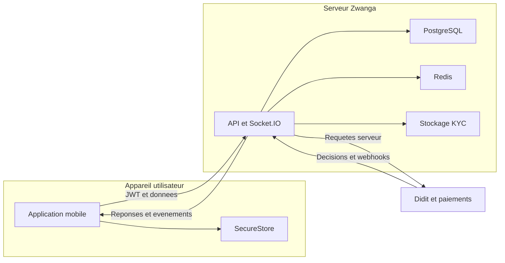

## Executive summary

Modèle ciblé du 24 octobre 2026, fondé sur les sources locales et les essais décrits dans [le rapport de sécurité](docs/operations/penetration-tests-2026-10-24.md). Les protections JWT, rôles, sessions et échanges mobile résistent aux scénarios essayés. Le risque confirmé le plus important se situe dans la frontière de confiance Didit : repli sur le statut du client et fraîcheur d'un événement signé contrôlée séparément de son contenu. Aucune compromission de production n'a été démontrée.

## Scope and assumptions

Suivi après audit, le même jour : SEC-001 et le rejeu ancien de SEC-002 ont été
corrigés localement, avec tests adverses de non-régression. Les en-têtes HTTP ont
également été renforcés. Les scénarios ci-dessous décrivent l'état initial de
l'audit ; voir le [suivi et ses limites](docs/operations/penetration-tests-2026-10-24.md)
pour l'état corrigé. Pas de déploiement ni de déduplication générale `event_id` ajoutée.

- Périmètre : `src/`, bootstrap HTTP/Socket.IO, services KYC/financiers/authentification ciblés ; code mobile `../zwanga` et Android debug installé.
- Confirmation utilisateur : PostgreSQL/Redis locaux avec données de test uniquement ; émulateur Android et application configurée pour le backend local.
- Les clés de prestataires présentes ne prouvent pas qu'il s'agit de comptes sandbox : aucune opération fournisseur n'a été exécutée.
- Hors périmètre : AWS, déploiement, stores, CI/CD, application admin, iOS natif, DoS, fraude/paiement réel, extraction des données utilisateurs.
- Questions restantes : comportement réel de Didit lors d'une réponse incomplète ; exposition effective des outils de développement via le pare-feu ; protections du binaire release et en-têtes du proxy de production.

## System model

### Primary components

API NestJS/Express (`src/main.ts`, `src/app.module.ts`) ; TypeORM/PostgreSQL et Redis via les services existants ; namespaces Socket.IO chat/tracking (`src/chat/chat.gateway.ts`, `src/tracking/tracking.gateway.ts`) ; services KYC et paiement ; mobile Expo/React Native avec SecureStore et RTK (`../zwanga/services/tokenStorage.ts`, `../zwanga/store/api/baseApi.ts`).

### Data flows and trust boundaries

- Mobile → API : Bearer JWT, identifiants, profils, montants et intentions ; HTTP local, HTTPS prévu pour les URL distantes ; contrôles JWT, identité serveur, rôles et ValidationPipe (`src/main.ts`, `src/auth/strategies/jwt.strategy.ts`). Les champs du client ne sont pas des preuves de paiement/KYC.
- Mobile → Socket.IO : JWT, UUID de réservation et coordonnées ; sessions contrôlées, DTO et accès aux participants (`src/common/services/ws-session.service.ts`, `src/common/websocket-security.ts`).
- API → PostgreSQL : identité, dossiers KYC, soldes et écritures ; accès par services/repositories, transactions financières et verrouillage ; tests isolés de logique seulement dans cette campagne (`src/users/didit-kyc.service.ts`, `src/referrals/referrals.service.ts`).
- API → Redis : quotas, codes éphémères et présence/session ; opérations atomiques de limitation et services de coordination (`src/common/guards/throttler.guard.ts`, `src/auth/oauth-exchange.service.ts`). Pas de test de panne réelle de Redis ici.
- API ↔ Didit/prestataires : secrets serveur et décisions ; HTTPS, signatures/consultation de statut ; réponses externes à valider même lorsque le transport réussit (`src/users/didit-kyc.service.ts`, `src/payments/payments.service.ts`). Appels simulés uniquement.
- API → stockage de pièces : fichiers KYC et URL temporaires ; validation d'image, accès aux documents, signatures de liens et contrôle des destinations média (`src/common/local-upload-policy.ts`, `src/users/kyc-evidence/kyc-evidence.transport.ts`).
- Android → stockage/système : tokens SecureStore, liens entrants et activités ; isolation de l'application et activité d'alerte non exportée (`../zwanga/android/app/src/main/AndroidManifest.xml`). Le build debug n'établit pas les garanties d'un build release.

#### Diagram

## Assets and security objectives

| Asset | Why it matters | Security objective (C/I/A) |
|---|---|---|
| Sessions et PIN | Usurpation de compte et actions au nom d'autrui | C/I |
| Statut KYC et activation conducteur | Admission de personnes non vérifiées | I |
| Documents d'identité, coordonnées, conversations | Confidentialité et sécurité des personnes | C/I |
| Soldes, retraits et commissions | Protection des fonds et unicité des règlements | I/A |
| Secrets fournisseur et signatures | Autorité des paiements/vérifications | C/I |
| API, Redis, PostgreSQL | Continuité des échanges et opérations métier | A |

## Attacker model

### Capabilities

Client non authentifié pouvant émettre des requêtes HTTP/WebSocket ; utilisateur connecté pouvant modifier ses propres requêtes ; application Android tierce tentant une ouverture d'activité ; acteur possédant un ancien webhook signé dans le scénario de rejeu.

### Non-capabilities

Pas d'accès supposé aux clés JWT/HMAC, aux comptes AWS ou à la base ; pas de capacité présumée à forcer Didit à renvoyer une réponse malformée ; pas d'accès root au téléphone supposé. La clé synthétique utilisée dans la reproduction ne représente pas une fuite de clé réelle.

## Entry points and attack surfaces

| Surface | How reached | Trust boundary | Notes | Evidence |
|---|---|---|---|---|
| API privée/admin | HTTP Bearer | Client → serveur | Authn et rôles serveur | `src/common/guards/`, `src/auth/strategies/jwt.strategy.ts` |
| OTP/PIN/OAuth publics | HTTP | Anonyme → identité | Pas d'envoi réel ; tests isolés | `src/auth/auth.controller.ts`, `src/auth/pin-reset.spec.ts` |
| Synchronisation KYC | POST authentifié | Mobile/fournisseur → décision | Repli client vulnérable | `src/users/didit-kyc.service.ts:272` |
| Webhooks KYC/paiement | POST public | Fournisseur → serveur | Authenticité et fraîcheur distinctes | `src/users/users.controller.ts:187`, `src/payments/payments.controller.ts` |
| Chat/GPS | Socket.IO | Client → participants | Auth et accès aux rooms | `src/chat/chat.gateway.ts`, `src/tracking/tracking.gateway.ts` |
| Uploads/médias KYC | HTTP/fetch serveur | Fichier distant → stockage | Taille, format, DNS/destination | `src/common/image-upload-policy.ts`, `src/users/kyc-evidence/kyc-evidence.transport.ts` |
| Liens/activité Android | Intent système | Autre application → Zwanga | Activité interne refusée en essai | `../zwanga/android/app/src/main/AndroidManifest.xml:38` |
| Swagger, cartes, chatbot | Routes publiques | Anonyme → ressources | Surface publique et consommation à surveiller | `src/main.ts:259`, `src/google-maps/google-maps.controller.ts`, `src/chatbot/chatbot.controller.ts` |

## Top abuse paths

1. Approbation indue → utilisateur avec session KYC propre → statut client `Approved` → réponse fournisseur sans statut → compte activé. **Reproduit hors réseau**, précondition fournisseur non établie en production.
2. Rejeu KYC → possession d'un ancien message signé → en-tête courant avec corps inchangé → vérification acceptée → risque de décision périmée si rafraîchissement fournisseur indisponible. **Vérification reproduite**, effet métier réel non tenté.
3. Accès admin → JWT sans signature ou rôle auto-déclaré → lecture admin. **Bloqué** sur le serveur local et dans les tests des guards.
4. Accès au chat/GPS d'autrui → abonnement à une réservation étrangère → interception d'événements. **Bloqué dans les tests Socket.IO isolés**, contrôle d'absence de session également confirmé sur serveur actif.
5. Retrait non financé → montant supérieur aux fonds disponibles ou rejeu d'intention → double règlement. **Tests de logique ciblés réussis** ; aucune tentative de versement ni campagne transactionnelle exhaustive ici.
6. Vol de session mobile → réponse de refresh retardée après déconnexion/changement de compte → restauration de l'ancien compte. **Bloqué dans les tests JS** ; pas d'extraction du stockage natif.
7. Accès médias internes → URL KYC manipulée vers réseau privé ou traversée de fichier → exposition de données. **Tests de transport simulés et traversée locale négatifs** ; pas de requête vers les métadonnées cloud.

## Threat model table

| Threat ID | Threat source | Prerequisites | Threat action | Impact | Impacted assets | Existing controls (evidence) | Gaps | Recommended mitigations | Detection ideas | Likelihood | Impact severity | Priority |
|---|---|---|---|---|---|---|---|---|---|---|---|---|
| TM-001 | Utilisateur authentifié | Session propre ; HTTP 200 fournisseur incomplet | Fournir un statut approbateur utilisé en repli | Approbation sans décision fiable | KYC/activation | Appartenance de session, transaction (`didit-kyc.service.ts`) | Statut client accepté en repli | Ignorer statut client ; conserver décision durable ; reprise | Compter décisions fournisseur invalides, alerter sans PII | medium : anomalie fournisseur nécessaire | high : contrôle d'identité contourné | high |
| TM-002 | Détenteur d'un webhook capturé | Corps authentiquement signé déjà obtenu | Rafraîchir uniquement l'en-tête temporel | Événement périmé accepté | Décision KYC | HMAC et consultation fournisseur (`didit-kyc.service.ts`) | Fraîcheur non liée au contenu signé | Contrôler horodatage signé et doublons/progression | Écarts timestamps, événements déjà traités | low : fuite préalable nécessaire | high : statut sensible si repli fournisseur | medium |
| TM-003 | Client distant | Aucune session ou compte non privilégié | Falsifier identité ou rôle | Accès admin | Comptes/fonds | JWT, rôles en base, RolesGuard | Pas de campagne exhaustive de toutes les routes | Conserver tests adverses et compléter routes métier | 401/403 corrélés sans secrets | low : variantes essayées bloquées | high : privilèges étendus | low |
| TM-004 | Participant malveillant | Compte/session valide | Abonner aux rooms d'autrui | Lecture GPS/chat | Données privées | Contrôles participants, revocation (`chat-access.spec.ts`, `ws-session.service.ts`) | Matrice complète HTTP/WS restant à compléter | Cas deux comptes sur chaque action | Refus d'accès aux rooms | low : contrôles présents | high : sécurité des personnes | low |
| TM-005 | Utilisateur financier | Compte avec intention de retrait | Modifier fonds/idempotence | Double dépense | Soldes/retraits | Réservation et clés liées au compte (`referral-withdrawal-balance.spec.ts`, `transfer-idempotency.spec.ts`) | Concurrence DB/pannes réelles hors campagne | Suite PostgreSQL isolée, preuve fournisseur et reprise | Écarts ledger/réservations/fournisseur | low pour cas couverts, reste non quantifié | high : perte de fonds | medium |
| TM-006 | Réponse retardée ou application tierce | Appareil/session en transition | Restaurer ancien compte ou ouvrir activité interne | Usurpation locale/interaction trompeuse | Session mobile | Version de session, SecureStore, `exported=false` | Release/iOS/stockage non testés nativement | Recette release et tests inter-apps | Diagnostics anonymisés de révocation | low sur cas essayés | high pour session, medium pour activité | low |
| TM-007 | URL/fichier hostile | Entrée média ou fichier accessible | SSRF/traversée | Secrets et pièces | Stockage/serveur | Format image, URL signée, DNS et redirections (`image-upload-policy.spec.ts`, `kyc-evidence.transport.spec.ts`) | Pas de test cloud, volontairement | Maintenir contraintes et tests négatifs | Refus de formats et destinations | low sur contrôles essayés | high : documents sensibles | low |
| TM-008 | Consommateur anonyme | Accès aux routes publiques | Multiplier les requêtes coûteuses | Coûts/disponibilité | API/Redis/prestataires | Quotas Redis, cache/timeout (`throttler.guard.ts`, `google-maps.service.ts`, `chatbot.service.ts`) | Budget global/distribution IP non évalués | Limites globales par fournisseur, métriques et seuils | Quotas, coûts, files et latences | medium : interfaces publiques | medium : consommation/ralentissement | medium |

## Criticality calibration

- **critical** : retrait arbitraire sans authentification ; lecture massive de pièces KYC sans contrôle. Aucun de ces scénarios démontré.
- **high** : approbation KYC sans décision fiable ; contournement effectif admin ou accès GPS d'autrui. TM-001 est confirmé dans ses conditions simulées.
- **medium** : rejeu exigeant un message signé préalablement obtenu ; consommation abusive de services publics malgré quotas par IP. Ces préconditions réduisent la vraisemblance.
- **low** : identification d'Express ; exposition Swagger en environnement de développement ; défauts de durcissement sans chemin d'accès aux données démontré.

## Focus paths for security review

| Path | Why it matters | Related Threat IDs |
|---|---|---|
| `src/users/didit-kyc.service.ts` | Autorité des décisions et validation des signatures | TM-001, TM-002 |
| `src/auth/strategies/jwt.strategy.ts` | Identité et révocation réellement vérifiées | TM-003 |
| `src/common/guards/` | Permissions et quotas | TM-003, TM-008 |
| `src/chat/chat.service.ts` | Appartenance et projections des conversations | TM-004 |
| `src/common/services/ws-session.service.ts` | Révocation des abonnements passifs | TM-004 |
| `src/referrals/` et `src/payments/` | Réservation financière et décision fournisseur | TM-005 |
| `src/users/kyc-evidence/` | Destinations média et confidentialité | TM-007 |
| `../zwanga/services/tokenStorage.ts` | Persistance et transitions des jetons | TM-006 |
| `../zwanga/hooks/useDiditKycFlow.ts` | Reprises et résultats KYC client non autoritatifs | TM-001, TM-006 |
| `../zwanga/android/app/src/main/AndroidManifest.xml` | Entrées inter-applications | TM-006 |
| `src/google-maps/` et `src/chatbot/` | Consommation des ressources publiques | TM-008 |

## Notes on use

Cette modélisation est une carte des risques, non une liste de vulnérabilités toutes exploitables. Les constats SEC du rapport distinguent reproductions, observations et limites. Aucun correctif fonctionnel ni configuration de production modifiés.

Contrôle qualité : surfaces découvertes regroupées ; chaque frontière principale représentée ; runtime/dev distingués ; CI/build de production hors périmètre ; réponses utilisateur intégrées ; préconditions, inconnues et résultats négatifs explicités. Les compétences de revue sécurité et de modélisation ont conduit à séparer tests actifs, simulations et hypothèses, et à exclure les appels payants.
